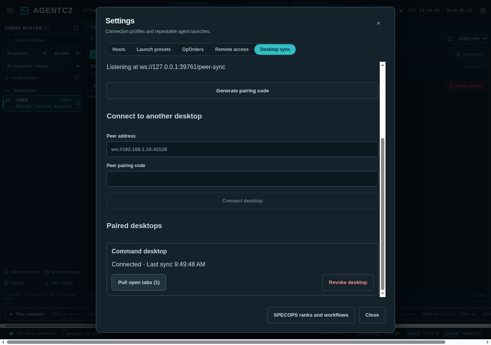
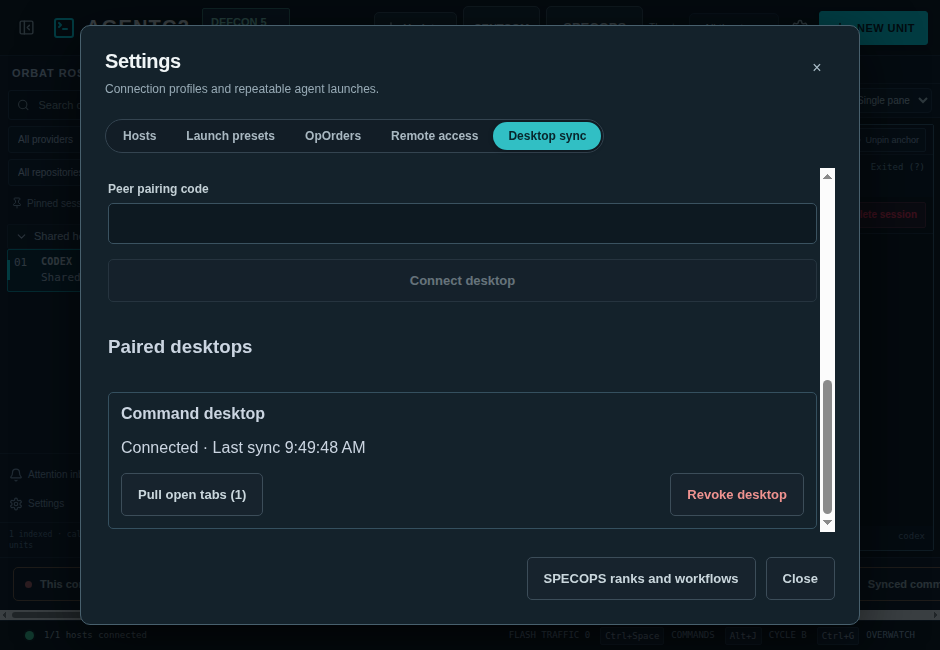

# Desktop sync over LAN or VPN

Pair trusted AgentC2 desktops in **Settings → Desktop sync**. Each peer can change the shared fleet configuration; pair only machines you trust to operate that fleet.

1. Enable desktop sync on each computer, choose a device name, and bind to its private LAN or VPN IPv4 address. The default port is 43128. Loopback (`127.0.0.1`) works with an SSH/VPN tunnel. Port 0 chooses a temporary port for testing; use a fixed port for reconnects.
2. Apply the settings. Allow the chosen port through the host firewall. Public addresses, wildcard binds, DNS names, and browser-origin connections are rejected. There is no LAN discovery or broadcast.
3. On one desktop, select **Generate pairing code**. Enter its address and code on the other desktop and select **Connect desktop**. The code expires after 15 minutes and is consumed once. The address starts with `ws://`; the application encrypts authenticated peer frames independently of WebSocket transport.
4. Both desktops display the connection. Changes reconcile automatically after sleep, disconnection, or restart. **Revoke desktop** disconnects it immediately and invalidates its credential on this computer. Revoking one link does not revoke another independently paired link or erase previously shared settings.

## Shared and local state

Shared entities are SSH host definitions, launch presets, host Rules of Engagement defaults, enrolled OpOrders, cleanup policies, session notes/project/pins, callsigns, confirmed deleted-session tombstones, and attention acknowledgements. Enabled OpOrders and cleanup policies retain their enabled state on the receiving desktop. Existing service checks still defer host connection changes while terminal or chat views are open, or cleanup is busy; the sync panel displays the reason and retries when the conflict clears.

Machine-local hosts and their associated presets, policies, notes, callsigns, and tabs remain local. A shared ID that collides with a local host or preset is rejected with an actionable sync error. Each desktop uses its own OpenSSH configuration and host-key verification. The sync engine never reads or sends private key files, agent sockets, provider auth stores, terminal output, or transcripts. Text deliberately placed in shared presets, OpOrders, and notes is shared.

Open tabs, pane selections, focus, grouping, keyboard overrides, and notification preferences remain independent. **Pull open tabs** explicitly replaces this desktop's open tabs with the peer's last received remote-session tabs and selects the first tab. Local-session tabs are excluded. Confirmed history deletions remove matching tabs and metadata on every peer without issuing additional remote deletion commands.

Attention acknowledgements match the host-qualified session and provider event signature, because each desktop gives the same observed alert a different local UUID. Unacknowledging an already shared event cannot resurrect it. Provider hook event IDs distinguish later turns.

## Reconciliation and transport

Each shared entity has a persisted logical timestamp, originating peer ID, and optional deletion marker. Timestamps advance monotonically past observed revisions; equal timestamps use the peer ID as a deterministic tie-breaker. Concurrent changes to the same entity resolve as one entity, rather than merging individual note fields. Deleted-session and acknowledged-event sets only grow. Callsign collisions resolve in stable session-key order; shared callsigns take precedence over a colliding machine-local callsign. Invalid combined configurations remain unapplied and visible as sync errors.

The listener accepts up to eight paired peers. A 256-bit random pairing code proves possession through mutual HMAC-SHA256 challenges; the code is never transmitted. A per-pair credential is derived with HKDF-SHA256. Reconnects use fresh challenges and derive separate send/receive keys. AES-256-GCM frames have strictly increasing sequence numbers, authenticating payloads and rejecting tampering, replay, and cross-connection reuse. Authentication has a ten-second deadline; frame, state, peer, and queue sizes are bounded. Reconnect attempts back off to one minute. Authentication provides no forward secrecy if a stored pairing credential is later compromised; use a private VPN/tunnel for additional network protection.

Credentials, revision records, and the last applied local snapshot are atomically saved in `peer-sync.json` with mode 0600 on POSIX. The snapshot distinguishes local offline edits from unapplied remote revisions on restart. The file is local-only and is not part of the exported sync envelope. Disabling desktop sync closes all peer connections while continuing to record local revisions for a later reconnect.

This first implementation supports literal private IPv4 WebSocket endpoints. It does not provide DNS discovery, IPv6, TLS certificate provisioning, or per-field sharing switches. Full bounded snapshots are exchanged on entity changes; tab-only changes send a smaller view frame. Deletion/acknowledgement history is retained until the bounded state limit is reached, rather than silently expiring tombstones.

## Verification

`tests/peer-sync.cjs` uses two isolated production services and real loopback WebSockets for fleet state, notes/pins/callsigns, acknowledgements, local exclusions, independent/pulled tabs, offline conflicts, preset deletion, enrolled OpOrders, restart, connection retarget guards, and revocation. It also checks code expiry/single use, invalid origins/authentication, endpoint restrictions, encrypted contents, tampering, replay, and session-key isolation.

`tests/peer-sync.e2e.cjs` pairs two actual Electron instances through Settings and verifies live UI updates, error recovery, tab adoption, revocation, renderer isolation, and the 940px layout. Both suites are registered in the required test inventory. Tests use isolated data directories and deterministic inventories without SSH, provider credentials, or paid calls. LAN/VPN reachability and host firewall configuration require testing on the target network.

