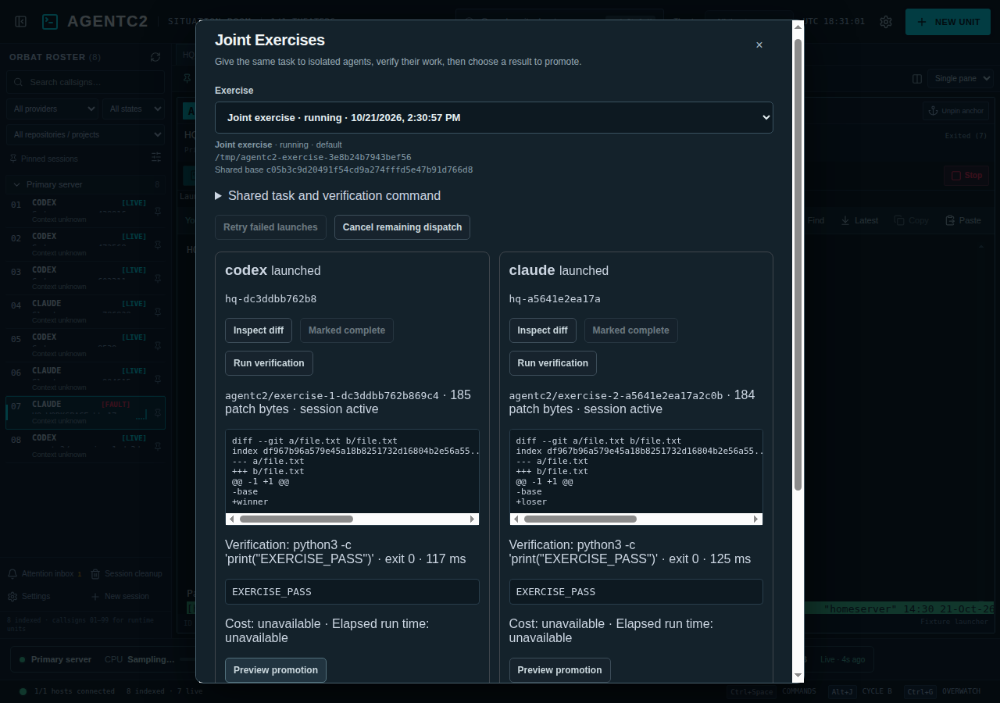
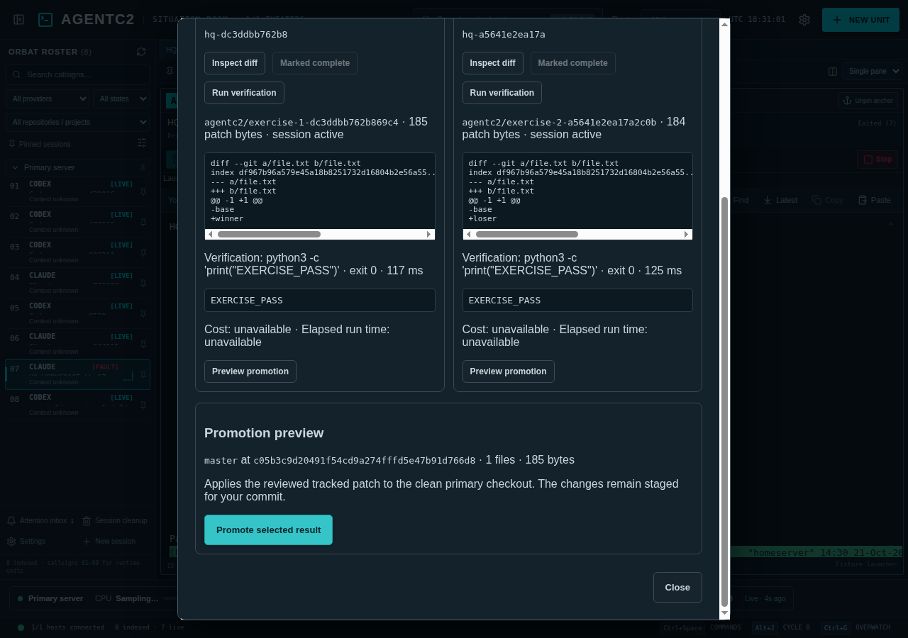

# Joint Exercises

Open **Joint Exercises** with Command mode (`Ctrl+Space`, then `B`). Select one SSH host, the primary Git checkout, a base ref, a shared task, two or three contestants, and an optional verification command. Each contestant can use its own provider preset and Rules of Engagement profile. The selected provider binaries must be installed on the host; launch failures remain visible and can be retried.

AgentC2 resolves the base ref once to a commit before dispatch. Each contestant gets a distinct owned branch, worktree, index, and managed tmux unit from that commit. Starts are serialized through the existing managed-launch lock; after launch, the agents run at the same time. The local private workspace stores the exercise definition and individual operation IDs before dispatch, so a partial launch or desktop restart can be retried without allocating new worktrees. **Cancel remaining dispatch** prevents future starts; already launched units remain available to stop or inspect separately.

When an agent finishes, use **Mark complete** if its session remains active, then **Run verification**. A stopped session can be verified without marking. Verification runs the exact command selected at creation in that contestant's worktree, with a 25-second timeout and an 8 KB output tail. AgentC2 records the command, exit status, duration, output, timestamp, and worktree revision. If the command changes the source, verification rejects it and asks for another review. An omitted command is shown explicitly; an active session still needs a completion mark. Silence never marks a winner.

The comparison displays each tracked patch, omitted untracked files, warnings, verification result, and unavailable cost/run-time metrics. Patches over 512 KB, binary changes, Git LFS pointer changes, and untracked files block promotion. Add untracked files to Git and inspect again. A failed or timed-out selected verification command also blocks promotion.

**Preview promotion** checks the exact reviewed winner revision against the clean primary checkout at the exercise's base commit. **Promote selected result** repeats the checks under the remote operation lock and applies the tracked patch to both the target index and worktree. The result remains staged for a human commit. A retry after a dropped SSH response succeeds only if the staged target patch exactly matches the reviewed winner and there are no other changes. A dirty or divergent target is left untouched. AgentC2 does not infer a winner or resolve conflicts.

Losing branches, worktrees, and provider conversations are preserved. After promotion, the exercise view offers a separate archive action only for an owned, inactive, clean, merged loser. Stop a managed loser through its session controls first. Dirty, active, or unmerged worktrees remain available for manual review.

The exercise definition and verification evidence live in the desktop's private `workspace.json`; ownership records live in the SSH account's private `~/.cache/agent-hq/worktrees/records`. Removing either record outside the app can prevent recovery. The desktop limits the exercise list to the latest 50 records and does not auto-delete remote worktrees.

Validation: `npm run test:ci`, `python3 tests/exercises.py`, and on an isolated SSH host `AGENTC2_HOST=... xvfb-run -a npm run test:exercises`. The live fixture uses shell presets for Codex and Claude labels to test routing, ownership, verification, and promotion without requiring account login. Actual provider completion semantics depend on the installed CLI and require separate live provider testing.
