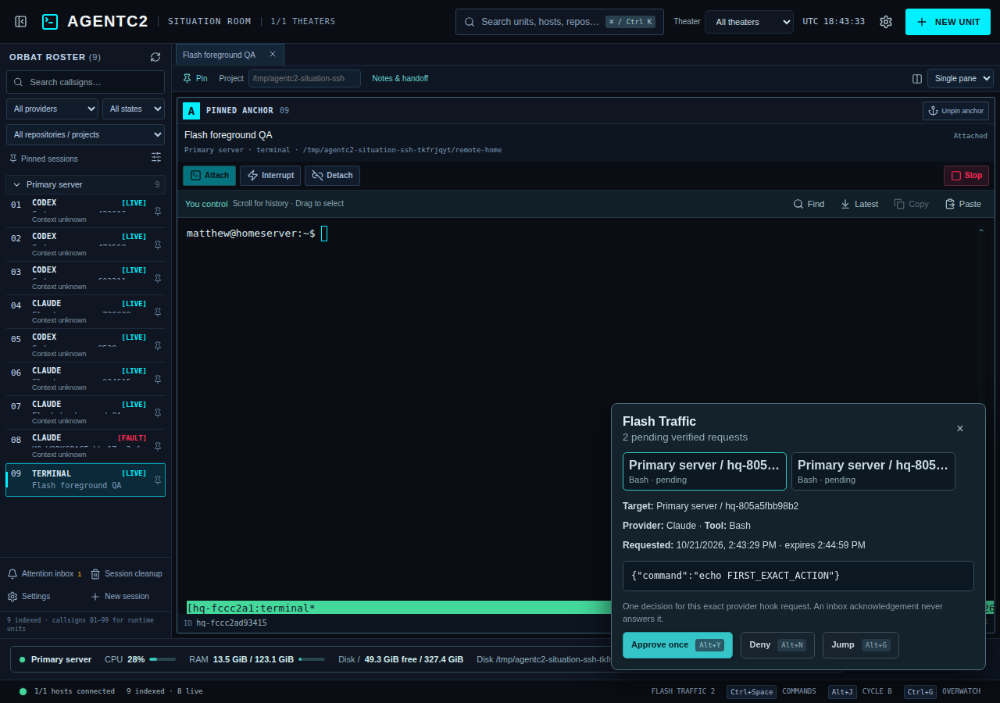

# Flash Traffic

Flash Traffic is a non-modal desktop queue for **verified Claude permission requests** from managed AgentC2 sessions with attention hooks enabled. Open it from the status bar. `Alt+Shift+Space` selects the next pending request (`Alt+Space` can be assigned on platforms that do not reserve it), `Alt+Y` approves the selected action once, `Alt+N` denies it, and `Alt+G` opens its unit. A keyboard decision leaves the foreground terminal focused. The queue shows the SSH host, managed unit, branch when known, provider, tool, exact bounded input, and expiry time.

Claude's [`PermissionRequest` hook](https://code.claude.com/docs/en/hooks#permissionrequest) is the decision boundary. Each hook invocation creates a private, random request ID and waits at most five minutes for an exact one-time `allow` or `deny`. AgentC2 sends the decision through the hook's documented JSON response. It never types `y` or `n` into a PTY based on transcript text. The SSH helper rechecks the live managed Claude tmux unit, hook process, request identity, and deadline while holding the request-file lock. If a phone controls an already attached unit, desktop decisions are rejected until control returns. A lost SSH response is never replayed automatically; the request ledger accepts a duplicate of the same decision only as an idempotent status read and rejects an opposite decision. A submitted decision means the hook recorded it; `resolved` means the hook emitted its response, not that the provider necessarily executed the proposed tool.

Requests and a bounded tool input live in the SSH account's private `~/.cache/agent-hq/<unit>/flash` directory until the managed session is stopped. Tool inputs over 4 KB, unsupported/malformed hook payloads, expired requests, stopped units, and unavailable hosts cannot be decided from Flash Traffic. They continue through the provider's own permission flow. Acknowledging an attention inbox item never approves a tool; once a correlated hook resolves or expires, AgentC2 acknowledges its related inbox alert. Inferred terminal prompts remain alerts only.

Codex and Antigravity decisions are currently unavailable in this queue. Codex's [official `PermissionRequest` hook](https://learn.chatgpt.com/docs/hooks) supports a similar response, but AgentC2 currently installs only a session notifier for Codex; enabling another hook source without verifying its trust and session scope could silently change approval behavior. The queue therefore leaves those requests in their native terminals. Claude's actual CLI decision path also needs validation on a host with an installed, authenticated Claude CLI; the isolated SSH fixture executes the documented hook protocol directly using a managed Claude-labeled shell session.

Validation: `python3 tests/flash.py`, `npm run test:ci`, and `AGENTC2_HOST=... xvfb-run -a node tests/flash.e2e.cjs` on an isolated SSH host. The live fixture checks two simultaneous exact-action requests, one allow and one deny, duplicate rejection, and stable foreground focus.
