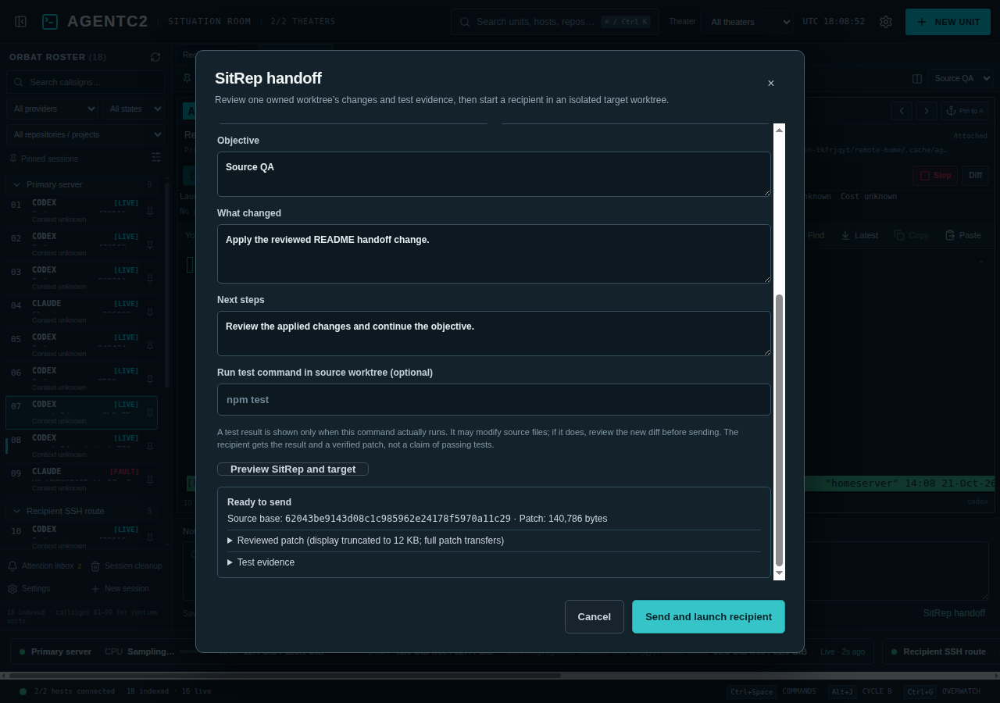

# SitRep handoffs

Select a connected managed unit with an AgentC2-owned Git worktree, open **Notes & handoff → SitRep handoff**, or use command-mode **R**. A SitRep reviews the source worktree’s changes, an optional test run, and the recipient’s Git base before it starts a new agent. The source session and worktree remain untouched.

Enter an objective, summary of changes, next steps, target SSH host, recipient provider/preset, and task slug. On the same host, leave the target checkout blank to use the source’s primary checkout. On another host, enter the absolute path to a primary checkout that contains the source worktree’s recorded base commit. The preview shows the patch size and text, source base, untracked paths, target compatibility, and actual test command/exit/output when one was run. Tests run in the source worktree, with a 25-second limit and bounded output; a failed or timed-out command is reported as such. A command that changes source files makes that preview ineligible for launch until reviewed again.

The reviewed patch combines committed and tracked working changes since the source task’s base commit. Untracked files, binary changes, and patches over 512 KB block transfer and require attention in Git before retrying. An absent target base or patch conflict also blocks transfer. No change is silently omitted or claimed to have passed tests. A SitRep without a test command explicitly says no test was run.
The on-screen diff preview is capped at 12 KB and says when it is truncated; the full eligible patch is transferred.
Git LFS pointer changes also block transfer because the pointer alone would not provide the target object.

**Send and launch recipient** checks the source revision and target base again, provisions an owned target worktree at the recorded base, applies and verifies the reviewed patch, then launches the selected provider with the objective, summary, next steps, source identity, and test evidence. AgentC2 records the source host/unit/repository/revision in the target’s private worktree record. The operation ID remains fixed while the dialog is open, so a retry after an uncertain SSH result reuses an already-running recipient rather than creating a duplicate. If the desktop restarts during transfer, inspect **New unit → owned worktrees** on the target host for a `ready` or `launched` record before starting another task. A `ready` record shows its SitRep source and offers **Recover SitRep**: re-enter recipient instructions, choose the provider/preset, and review the target. Recovery checks the retained patch against the recorded digest and refuses changed files or untracked additions. A `launched` record already has the recipient; attach to it. No interrupted action is replayed automatically after restart.

The recipient uses its chosen Rules of Engagement profile, and provider binaries or a compatible preset must be available on the target host. Cross-host transfer carries a bounded reviewed patch through the existing host-key-verified SSH helper; it does not fetch missing Git commits or copy untracked files. The desktop must control the source unit to send a handoff, and the paired web companion cannot initiate one.

`tests/sitrep.py` covers source revisions, test provenance, binary/untracked limits, and read-only target compatibility. `tests/worktrees.py` covers patch-before-launch and retry after a simulated launch failure. The isolated SSH/Electron suite covers a source worktree, second SSH route, applied patch, cross-provider recipient, trace record, and duplicate-safe retry without using a model API.
