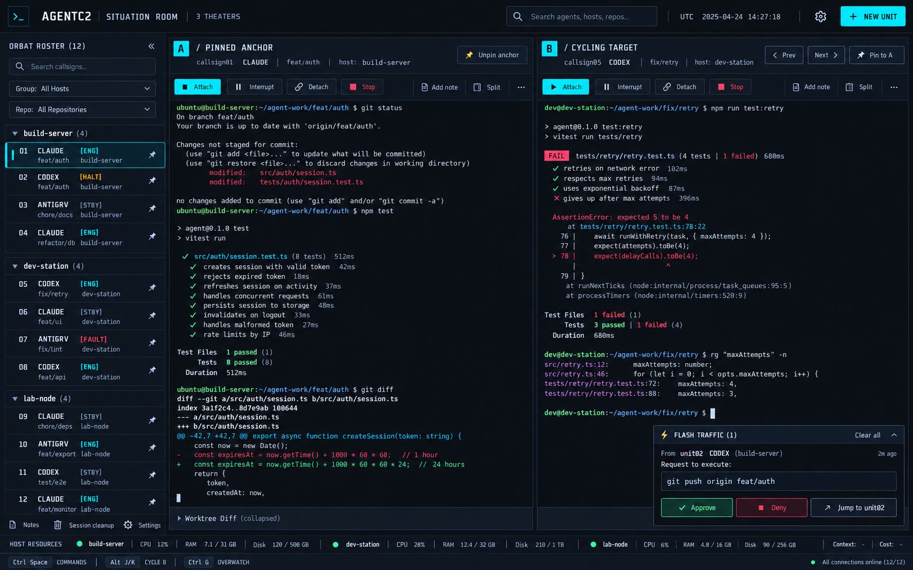
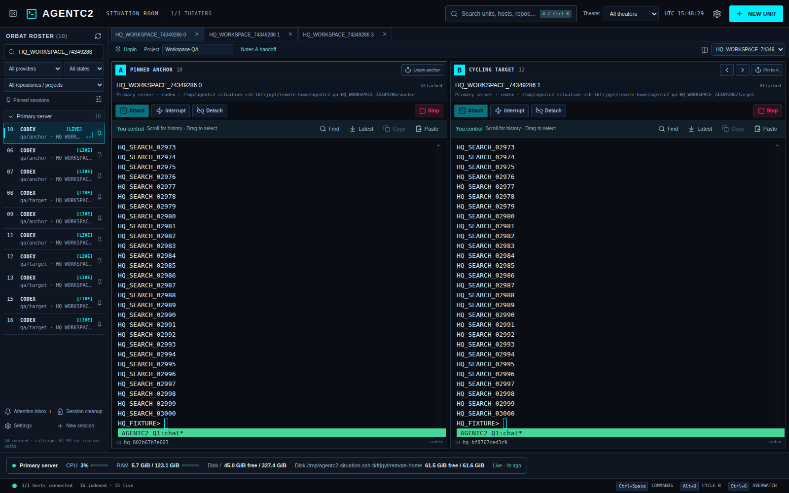
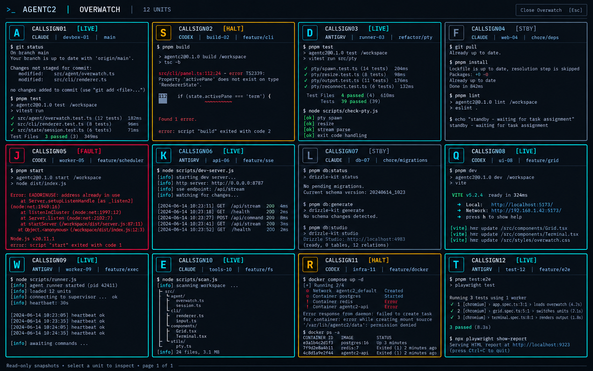
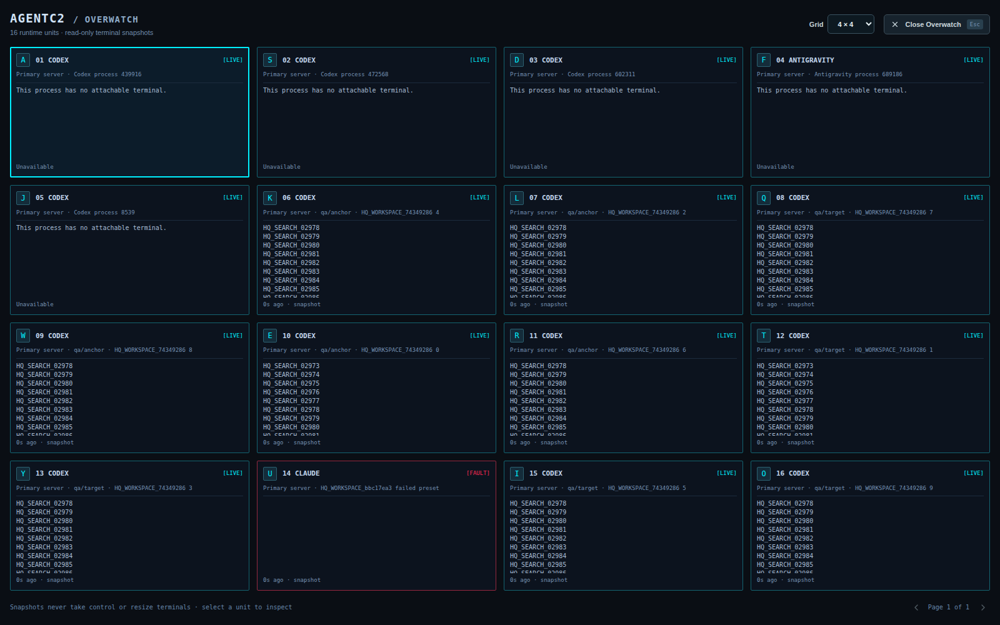

# Situation Room visual and behavior review

The two images below were generated as layout references with fictional units and terminal output. The implementation screenshots come from isolated Electron, SSH, Git, and tmux fixtures; they contain no provider prompts or real conversations.

| Concept | Tested implementation |
| --- | --- |
|  |  |
|  |  |

The [1000 by 760 screenshot](screenshots/situation-room-narrow.png) shows the stacked panes and compact header.

The implementation follows five measured parts of the reference: the 56px command header, the 220px grouped ORBAT rail, equal A/B viewports at desktop width, the shared host and command strips, and the four-column Overwatch grid. The palette uses the concept's canvas, panel, border, active, halted, fault, and standby tokens. At narrow width the panes stack and the header search becomes an icon to keep the host selector and Settings separate. Overwatch switches between 4×3 and 4×4 pages.

The concept's sample tests, diff drawer, and Flash Traffic card are illustrative. The implementation renders real retained terminal snapshots and measured host data; its unavailable actions state why they cannot run yet. A running process is labeled LIVE until agent activity is verified. Missing context and cost data are not fabricated. Existing tabs, favorites, notes, projects, terminal controls, and companion access remain available while the next epic subtasks add their backing services.

For local visual QA, `tests/workspace.e2e.cjs` captures the three implementation screenshots under the OS temporary directory. It checks the 1000px viewport for page and pane overflow and header-control overlap. The same suite checks that cycling B preserves A's focus and dimensions, command keys do not reach the PTY, read-only previews preserve control and size, shortcuts and pane assignments survive restart, and an unavailable host leaves the working host usable.

## Undock Overwatch

Open Overwatch with Ctrl+G or the footer button, then choose **Undock window** to move the snapshot grid to its own native window. The Situation Room remains interactive. Selecting a card or its jump key opens that unit in the main window while Overwatch stays open; opening Overwatch again focuses the existing window. **Dock to main window** returns to the full-window overlay. Closing the detached window closes only Overwatch. Closing the main window, including its background/tray action, closes detached Overwatch too.

The detached window reads shared inventory, callsigns, and snapshots. It cannot create or stop sessions, send input, edit settings, write the clipboard, or take terminal control. Docking and unit selection use dedicated validated IPC channels. Window placement and grid/page choices are not persisted across closing or docking.
