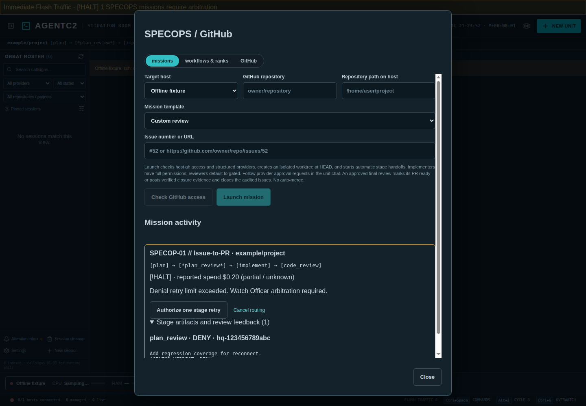
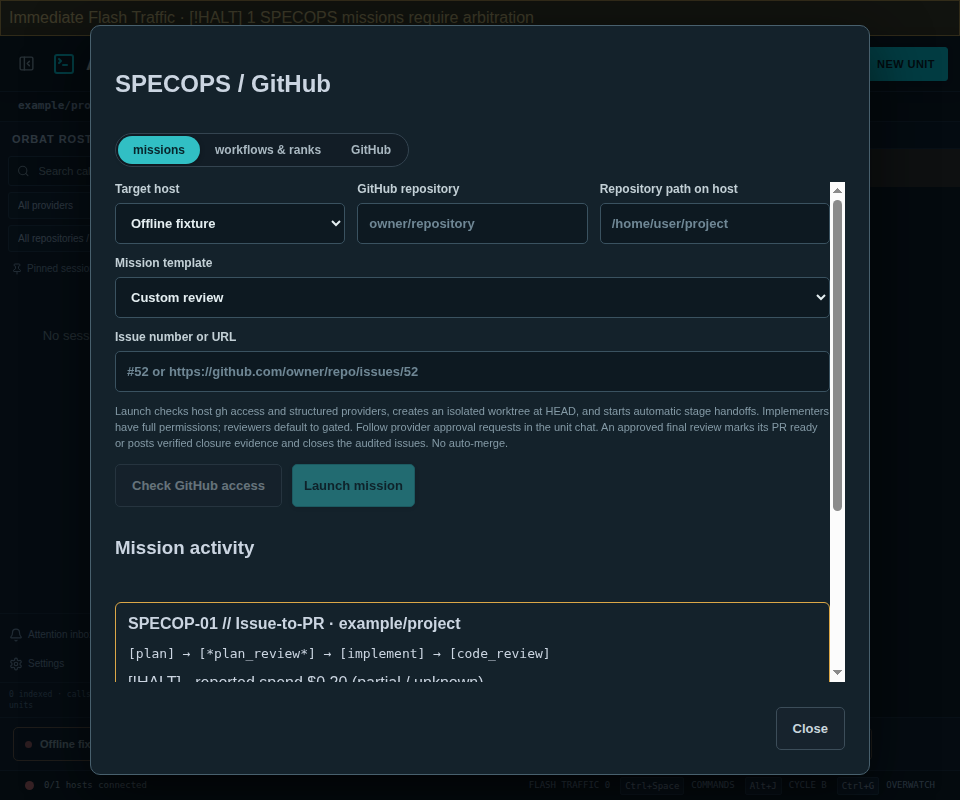

# SPECOPS and GitHub

Open **SPECOPS** in the Global Theater Header, or **Settings → SPECOPS ranks and workflows**. Select **workflows & ranks** to edit the versioned YAML, assign a profile to multiple ranks, or clone a workflow using a new unique `id`. Definitions live in `~/.agentc2/specops/specops.yaml`; mission records and artifacts live beside them in `runs.json`. An explicit desktop data-directory override puts both under that directory's `specops/` for portable/test isolation. External YAML edits load on app restart. Existing missions retain their launch-time definitions.

Profiles contain a display name, provider, provider model ID, and rank memberships. The supplied Astra, Fable, Sol, Luna, Opus, Sonnet, Haiku, Argon, and Gemini Flash entries are editable examples, not a guarantee of model access. Replace aliases with model IDs accepted by the selected host's installed provider/account before launch. Model selection travels through the structured chat protocol, durable journal, and native provider adapter. Provider readiness does not establish access to an individual model; a provider rejection halts the mission.

A workflow has `version: 1`, `id`, `name`, `trigger` (`github_issue` or `github_repo`), `max_loop_retries`, `max_steps`, optional `max_budget_usd`, and `stages`. Each stage has `id`, `profile`, `rank`, `role`, and `prompt_template`. Prompts support `{{repo}}`, `{{issue_number}}`, `{{target_host}}`, and `{{repository}}`; other placeholders are rejected. Non-reviewers use `next` or `transitions.on_complete`; reviewers use `on_approve` and `on_deny`. Optional `on_fault` routes verified failed turns. `COMPLETE` is a successful terminal target. Unknown references, invalid rank assignments, unreachable stages, unbounded retries, and denial/fault routes directly to completion are rejected. All cycles are bounded by the mission step limit.

The issue-to-PR template plans, reviews the plan, implements, and reviews the actual PR. The triage template scans up to 100 filtered issues, then independently audits closure evidence. Launch validates host `gh` authentication, GitHub access, checkout origin, and structured provider availability. It pins the local HEAD commit and creates one isolated worktree reused by all stages, including revisions. Planner/reviewer stages use **Gated**; implementers use **Full**. `allow_write: true` explicitly gives a planner/reviewer Full permissions. Existing sessions outside SPECOPS keep their prior launch behavior. Gated controls can request approval; worktrees and provider gates are not an OS security boundary. Answer verified requests in the corresponding unit chat.

Stage completion requires the launched send command's receipt, matching turn ID, a successful structured turn-completion event, and a final assistant artifact. Reviewers must end with exactly one `AGENTC2_VERDICT: APPROVE` or `AGENTC2_VERDICT: DENY` line. Prior artifacts and denial feedback are carried to the next stage. Plans are stored as final-response artifacts in the mission journal, so a read-only planner does not need permission to write `PLAN.md` to the repository. Missing, ambiguous, failed, or truncated evidence halts routing rather than inferring approval.

The final approving review can publish a workflow's configured `completion_action`. `ready_pr` requires a fenced `agentc2-actions` JSON block containing `number` and `headCommit`; the bridge rechecks the PR's current head and mission branch before marking it ready. `close_verified` requires `{"closures": [{"number": 52, "updatedAt": "original timestamp", "evidence": {"commit": "full SHA", "summary": "reviewed evidence"}}]}`. Candidates must match the input issue snapshot, remain unchanged and open, and cite a commit available locally and reachable from the GitHub default branch. The reviewer must establish that the commit actually resolves the issue; ancestry alone is not proof. Insufficient evidence stays open and is identified in the audit artifact for Watch Officer review. An empty closure list is valid. No workflow merges PRs.

The **GitHub** tab also offers explicit readiness, issue inspection, PR inspection/readiness, and evidence-backed issue closure. Credentials stay in the selected host's authenticated `gh` environment. Commands use argv arrays, bounded timeouts, explicit repository scope, and redacted error messages. GitHub.com is supported; GitHub Enterprise hosts are not currently configurable. Rechecks reduce stale-action risk but the GitHub CLI offers no atomic compare-and-swap across the read and mutation calls.

Denials beyond the configured limit halt the workflow and surface **[!HALT]** in the roster and Immediate Flash Traffic banner. Open SPECOPS to inspect the full artifact history. **Authorize one stage retry** grants one additional attempt after a verified completed turn and an idle prior session. **Resume observation** reconnects to a previously dispatched session without resending its prompt. **Cancel routing** stops handoffs; stop running units explicitly using their existing controls. The desktop must remain open for handoffs; remote provider work continues when it closes. Restart resumes observation of running stages, while uncertain launches/handoffs/publications halt. Partial or uncertain GitHub mutations are not automatically repeated; inspect GitHub before acting manually.

Budgets check reported cumulative stage costs before subsequent launches. If configured and cost becomes unknown, further stages halt. They cannot cap a provider turn already in flight. The default templates leave budgets unset and report unknown/partial costs honestly.

Validation: `npm run test:specops`, `npm run test:ci`, `python3 tests/chat-runtime.py`, and `xvfb-run -a npm run test:specops:ui` on headless Linux. UI fixtures use a private desktop store and an unreachable fixture SSH endpoint; unit/protocol tests use deterministic provider and GitHub fixtures. Authenticated remote end-to-end execution requires an explicitly configured `AGENTC2_HOST`, installed provider CLIs, accepted model IDs, and host `gh` authentication.

Verified on Linux on October 22, 2026: Node 22.23.4 CI, SPECOPS/GitHub fixtures, Python chat runtime/native fixtures, Electron desktop/native PTY smoke, and SPECOPS UI at 1440×1000 and 960×800. The desktop has an existing 940px minimum width. No authenticated live GitHub mutations or multi-provider SSH mission was run; `AGENTC2_HOST` was unset. Browser plugin was unavailable, so UI validation used the repository's Playwright/Electron path. Model availability, real-account permissions, and remote end-to-end handoffs still require deployment-host validation.

