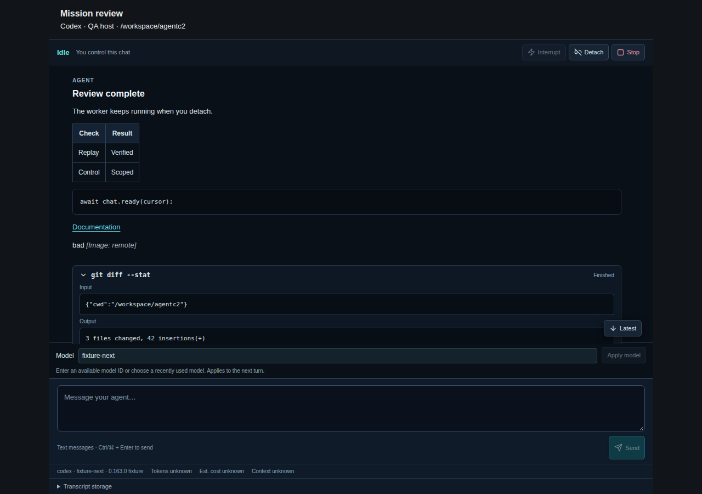
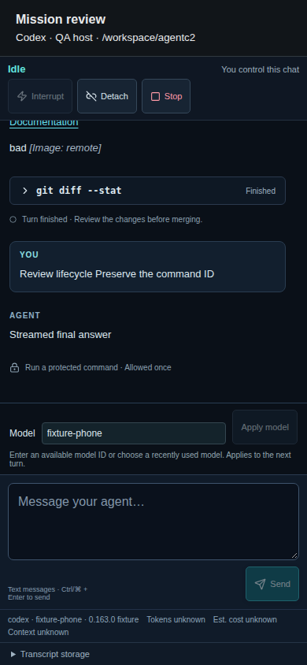
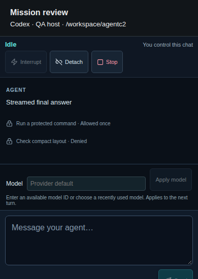
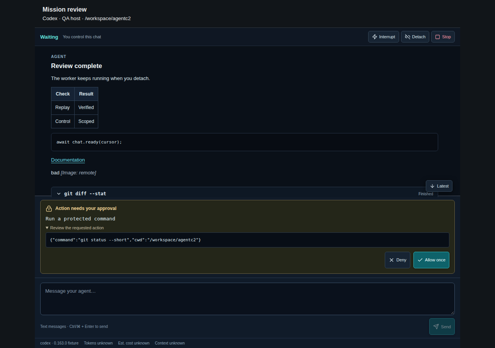
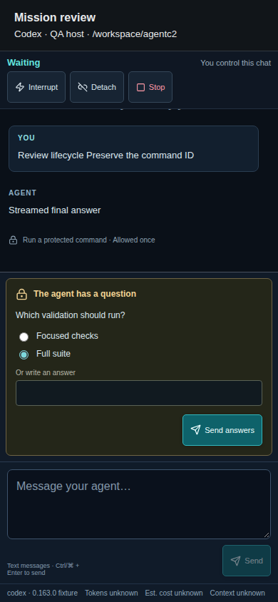
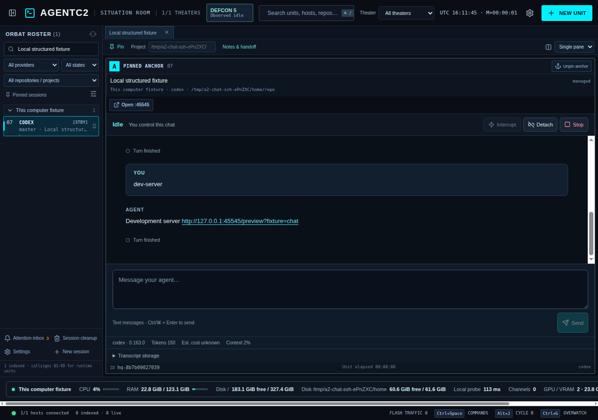
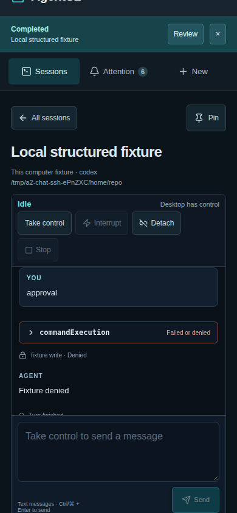

# Unified chat implementation

Tracked by [epic #28](https://github.com/mlg151/AgentC2/issues/28) and native sub-issues #30–#41. Local execution from related issue [#29](https://github.com/mlg151/AgentC2/issues/29) is included in this PR. The original provider research remains in the epic. Creating the issues does not establish that the integrations are implemented or verified.

## Current state

The versioned contract, remote journal, detached worker/bootstrap, provider adapters, shared service APIs, and desktop/phone chat views are implemented in the desktop and companion. Standard provider launches select structured chat after a host capability check; the launch dialog offers explicit Terminal mode. Custom commands/arguments, shells, and existing background-agent attachment retain terminal execution. Unsupported chat versions fail with an actionable Terminal fallback message.

Codex 0.163.0 and Antigravity CLI 1.4.4 passed live authenticated text turns and native-session resume/context checks both locally and on the explicitly authorized SSH host. These minimal live checks complement the pinned protocol fixtures; they do not validate every provider boundary. Claude SDK 0.2.172 with CLI 2.1.306 passed live text turns and native-context resume against both local model profiles (`claude-ornith`, `claude-sparkx`), plus eight installed-SDK/CLI boundary tests against a loopback model fixture. The sparkx live smoke required a 180-second per-turn budget; an earlier 90-second attempt timed out. Actual isolated SSH/tmux/worker/Electron launch, retry, approval, inventory, and worktree checks pass with a disposable Codex protocol executable. The disposable executable checks are transport/UI evidence; live provider evidence is recorded separately above. Those are historical CLI/model-profile results; the Antigravity SDK adapter described below has separate loopback boundary evidence, not a new live-account claim.

The contract has JavaScript/Python runtime validation and renderer types. Its manifest is `electron/chat-protocol.json`; command/event definitions are in `electron/chat-protocol.cjs`, `electron/chat_protocol.py`, and `src/chatTypes.ts`. Protocol version 1 rejects unknown commands and unexpected command fields. Candidate CLI versions are research targets, not a claim of end-to-end support. A provider must probe its actual host version and return verified capabilities before creating a structured session.

## Local sessions

In **Settings → Hosts**, choose **Add this computer**, enable it, and save. Select that host when starting chat or a terminal. Local execution uses Python 3 and tmux directly, requires no SSH server, and keeps the same worker ownership, receipts, detached sessions, and private storage as remote execution. Existing hosts remain SSH connections, including explicit SSH targets named localhost. Changing a connection while any device has an open view is rejected.

Linux local execution is verified with the production Electron app and paired phone companion. macOS uses the native Python/tmux path with Homebrew paths available to Finder launches; its CPU utilization remains unknown without Linux counters, and automatic native-history deletion remains fail-closed where process activity cannot be verified. Windows local execution runs in the **default WSL distribution**, where Python 3, tmux, provider binaries, credentials, and repositories must be installed. Windows drive-letter working directories such as `C:\` and `C:\Users\Matthew\` are converted through the default distribution's `wslpath`, including spaces and trailing separators. Existing WSL paths continue to work. A missing directory or unavailable WSL distribution reports a launch error and permits retry. WSL localhost forwarding must be enabled to open local dev URLs from Windows. Native macOS and Windows/WSL authenticated provider execution still require platform validation. `npm run test:ci` covers path conversion and service error recovery on every platform. `npm run test:windows:local` exercises the production Electron launch dialog and WSL/tmux with a Codex-labelled shell fixture and isolated HOME, covering missing-directory retry, drive roots, user directories, spaces, quotes, and POSIX paths. This live test requires default WSL Python 3/tmux; CI reports a skip when those prerequisites are absent.

Local localhost URLs open directly with their original port/path; remote host URLs still use scoped SSH forwarding. Clipboard PNGs are written with private permissions on the selected host. Existing commands such as `claude-ornith` and `claude-sparkx` can be saved as Claude launch presets and use Terminal mode; they are not silently converted into an SDK chat profile or copied into app configuration.

## Worker and data ownership

The ephemeral SSH helper installs a source-digested worker bundle into `~/.cache/agentc2/chat-v1/` on the selected account (local, SSH, or WSL). It creates an isolated Python virtual environment without requiring system pip, ensurepip, sudo, or manual SDK installation. Starting Claude or Antigravity chat automatically installs the pinned provider SDK from official PyPI wheels under a per-runtime lock. The Claude wheel includes its CLI; the Antigravity wheel includes its compiled runtime. First setup requires outbound access to PyPI and may take a few minutes; subsequent starts reuse the private environment. Failed setup reports an actionable host error and never falls back to an unrestricted CLI launch. The detached worker uses a locked private Unix socket and owns its provider processes. Worker directories use mode 0700; the socket, database, and worker log use mode 0600. Linux peer credentials must match the account running the worker. SSH host-key verification stays enabled; no provider credential is transported into the renderer or companion.

The desktop service has narrow chat capabilities, open/ready/history, take-control, submit, receipt, and close APIs. Companion operations use the existing authenticated WebSocket gateway and revocation rules. Client view handles are scoped to their connection. Taking control waits for any already-dispatched command acknowledgement before changing ownership. Detaching every client removes local polling/subscriptions and leaves remote work running. Connection failures block new mutations until recovery; commands are not queued offline.

An incompatible running worker is reported explicitly and is never replaced while it may own remote work. A worker can retire for an upgrade only after every managed session is confirmed stopped/failed and all accepted/dispatching commands have settled. Retirement fences new commands before shutting down, then the helper deploys the new bundle against the same journal. Worker crash recovery preserves journal records, marks active sessions and unfinished commands unknown, and expires obsolete live-process requests. Reattaching a healthy worker after an SSH disconnect is distinct from recovering a destroyed provider stdio connection after worker loss.

## Receipts and transcript recovery

Every mutation carries a UUID `commandId`. The worker commits the command fingerprint and receipt before dispatching. Repeating the same ID and content returns its receipt; changing the content is rejected. A send reserves its turn before acknowledgement so two simultaneous submissions cannot both start a turn.

Receipt states are `accepted`, `dispatching`, `completed`, `failed`, and `unknown`. `completed` means the command was acknowledged by the adapter; a `turn.completed` event separately records generation completion. `failed` indicates a definitive rejection. An uncertain provider acknowledgement or worker restart becomes `unknown` and must not trigger automatic resubmission. Inspect the receipt and provider history before deciding whether to start new work.

Events have monotonic per-session sequences and provider session/turn/item identities. History pages are bounded by event count and bytes. Approval/question requests persist with the exact request, turn, and item identity. One response reserves that request; conflicting replies, stale identities, and replies after turn completion are rejected. Streaming deltas and final messages retain the same item identity so clients can reconcile rather than concatenate duplicate output.

## Retention and access

Automatic transcript expiration is disabled by default. Structured transcripts and tool/request content are durable remote data beyond the existing metadata-only desktop workspace file. Only the remote account and authenticated paired clients through AgentC2 may access them. Companion static caching must never include transcripts or API responses.

Open **Transcript storage → Remove managed transcript** in desktop or phone chat to prune a confirmed stopped/failed session. The current controller must be connected and all accepted/dispatching commands must have settled. The worker enforces these conditions independently of the UI. Live, starting, waiting, and unknown sessions cannot be pruned. Pruning removes transcript/request content while retaining session mappings and command fingerprints/receipts to prevent old retries from repeating work. Sequence numbers never restart; a history response exposes `retainedFrom` and `truncated` when content was removed. Native-history cleanup rejects active or uncertain managed chat associations. Native-history cleanup and managed-transcript removal are deliberately separate operations. The UI explains this before removal; deleting native provider history does not erase the separate journal. Session IDs, fingerprints, receipts, and diagnostic receipt errors remain after pruning; automatic expiration is disabled.

## Managed roster and session deletion

Desktop ORBAT and Overwatch show only AgentC2-managed sessions. External tmux sessions, unmanaged processes, background processes, and saved provider conversations do not receive callsigns or enter runtime cycling. Each roster row reserves its second line for the session name; unknown or unsupported context text is omitted. Reported context remains a thin meter. Saved resumable conversations remain available in the quick switcher (Ctrl/Cmd+K) and through history cleanup.

Select a managed session and choose **Delete session** in its toolbar. The confirmation explains that deletion stops active work and removes the session, open tabs, and workspace notes. Deletion requires a connected host and respects the current controller. Chat deletion waits for a completed stop receipt; failed or uncertain stops leave the session visible. Confirmed stopped/failed chats can also be deleted. Persistent deletion records keep the entry out of inventory across refresh, restart, and stale workspace saves.

Deleting a session keeps repository/worktree files, provider-native conversation history, and the separate managed transcript. Use history cleanup or **Transcript storage → Remove managed transcript** for content removal before deleting the session.

## Validation

Use Node.js 22 LTS and Python 3. Run `npm run test:chat` for the renderer build, shared contract parity, SQLite/journal recovery, detached worker fixtures, service ownership/replay, and authenticated gateway tests. Linux worker tests launch only disposable fixture processes and never submit prompts to installed providers. Windows runs wire validation/parity; remote worker lifecycle tests target Linux. Each fixture cleans up its owned processes and files.

The tests cover lost acknowledgements, concurrent retries and sends, request replay/correlation, stale replies, worker restart uncertainty, transcript pruning, duplicate bootstrap, helper exit, scoped stop, controller races, reconnect, late subscriptions, and gateway revocation. Passing fixtures do not prove real provider authentication, protocol behavior, or live model turns. Those gates remain in #34/#37/#38/#41, alongside desktop/phone screenshots, workflow migration, and existing terminal/worktree/companion regressions.

## Codex adapter evidence and limits

Codex uses app-server over stdio with an initialization handshake, host-side authentication checks, create/resume, paginated history import, correlated approvals/questions, steering, and interruption. The adapter probes the exact schema-supported version before launch. `scripts/generate-codex-chat-schema.cjs` regenerates the checked-in structural schemas from Codex 0.163.0. Other versions remain unavailable until their protocol and behavior are validated. No model name is hardcoded; host configuration supplies it.

ROE matches existing terminal behavior: full sets `approvalPolicy=never` and `sandbox=danger-full-access`; gated sets `approvalPolicy=on-request`, `sandbox=read-only`, and `approvalsReviewer=user`. The adapter checks the returned effective values before accepting a session. Provider-default inherits the host configuration. The adapter does not change the terminal launch flags. Attachments and forks remain unavailable in the structured adapter until their controls are implemented and validated.

The Codex fixtures cover streamed/final reconciliation, cumulative token usage with unknown cost, allowed/denied writes, questions, expected-turn steering, interruption, paginated resume, authentication failure, effective ROE, bounded output, and command/receipt dispatch through the deployed worker bundle. The installed CLI test uses an isolated unauthenticated Codex home and submits no model request. Live authenticated create/resume text turns with context continuity also pass locally and over the authorized SSH host; live permission/interrupt edge coverage remains incomplete. `tests/chat-launch.e2e.cjs` provisions its own disposable localhost SSH daemon, key material, isolated HOME, tmux socket, repository, and fixture provider; it exercises actual SSH and, under Xvfb, the production Electron view and paired companion through the real authenticated gateway. The flow covers question answers, disconnect during a pending approval, request recovery, denial, control reclaim, device revocation, rendered native-history resume with preserved ROE, development forwarding, and safe transcript removal without touching a configured user host.

## Claude SDK integration

The daemon automatically prepares `claude-agent-sdk==0.2.172` in its private environment and prefers the bundled Claude CLI (2.1.308). A separate system CLI installation is not required. CLI 2.1.306 remains recognized for compatible explicit environments. The adapter requires API or supported cloud-provider authentication in the remote environment and does not reuse personal CLI subscription sign-in. Credentials remain in the provider process environment; the service and renderer receive capability/setup status.

SDK options explicitly load user/project/local settings and the Claude Code system preset in the requested working directory. Gated mode retains session ask rules for Bash/Edit/Write/NotebookEdit; full retains bypassPermissions. Approvals use the SDK callback. AskUserQuestion uses a PreToolUse hook so it remains interactive in full mode, with the SDK stdio permission channel enabled. Decisions bind to the exact tool-use ID and managed turn. Requests expire if cancelled or after the configured provider-hook waiting period, and their UI replies cannot authorize another tool.

Eight installed SDK/CLI loopback tests verify exact gated allow/deny, project instructions, full-mode questions, native history import/resume with retained context, interruption of a pending permission followed by another turn, independent one-shot decisions for a batch of tools, and malformed-question cleanup. A synthetic SDK background-result event injected during the native permission flow verifies that background notifications cannot complete the foreground turn or inflate its usage; this is routing evidence rather than a claim of native background-agent integration. They use a local model-response fixture, an isolated Claude configuration directory, and a dummy API key. No external Anthropic model turn or user credentials are used. Run `python3 tests/chat-runtime.py` to exercise cold daemon installation and all eight boundary tests against the bundled 2.1.308 CLI. The basic host-independent suite skips them when the SDK is absent; the SDK runtime CI step installs and runs them explicitly.

Claude usage normalization reads the latest cumulative `model_usage` and cost estimate, including cache-input tokens. It does not sum cumulative results across turns. Per-turn `usage` is retained in provider metadata. Unknown pricing remains unknown; reported SDK cost is an estimate. Context usage is shown only when the last main-agent message provides the necessary fields.

## Antigravity SDK integration

Structured chat uses `google-antigravity==0.1.22`, installed automatically into the host daemon's private environment. The wheel ships its compiled harness; an `agy` installation is not required for chat. Terminal mode still uses the installed CLI. Host authentication uses `GEMINI_API_KEY` or the SDK's Vertex environment configuration; existing CLI sign-in is not silently repurposed. An explicitly configured OpenAI-compatible endpoint can be selected with host environment variables `AGENTC2_ANTIGRAVITY_BASE_URL` and `AGENTC2_ANTIGRAVITY_MODEL`.

The adapter owns a persistent SDK Agent, streams text/tool events, records cumulative usage with unknown cost/context left unknown, and saves SDK-native conversations below the private journal's `antigravity-sdk/` directory. Resume imports message history and verifies native identity. CLI-native IDs are rejected with an explicit Terminal-resume instruction, without creating a replacement conversation.

Full ROE explicitly uses `policy.allow_all()`. Gated structured chat uses `policy.safe_defaults()` with correlated approval callbacks. Provider-default retains the SDK's default policies, including denial of shell execution. SDK questions map native option IDs to desktop/phone cards. Allow/deny/answers bind to the original request, turn, and item; duplicate or stale decisions are rejected. Interrupt cancels the SDK response and pending requests. Stop closes the SDK Agent and only the worker-owned reservation.

`tests/chat-antigravity-sdk.py` exercises the real pinned SDK and compiled harness with a disposable loopback model: streaming, native persistence/resume and context continuity, allow/deny witnesses, stale decisions, question-option mapping, and interrupt during approval. No cloud model calls or user credentials are used. Live Gemini/Vertex account validation and native macOS/Windows-WSL SDK execution remain untested. Attachments, steering, and forks remain disabled. [SDK deployment and compatibility details](antigravity-sdk-evaluation.md).

## Desktop and companion operation

Choose **New → Interaction mode → Structured chat** for a standard supported provider command. Choose **Terminal** for legacy CLI interaction or custom preset arguments. Credentials must be available to the selected host execution environment, not only to a shell alias. The daemon installs the pinned SDK automatically; API/cloud authentication must already be configured on that host. AgentC2 does not provision or copy keys.

Chat renders safe Markdown, collapsed tool input/results, explicit outcomes, and exact approval/question cards. Messages are text only. Unsupported attachments/forks are not offered. Ctrl/Command+Enter sends; regular Enter inserts a newline. **Take control** owns mutation rights for the current desktop/phone connection. **Detach** closes only the view, **Interrupt** cancels the active turn when supported, and **Stop** ends the worker-owned process. A stopped conversation remains readable and can be resumed using its native provider ID.

### Model selection

The launch dialog accepts an optional **Launch model** ID for structured chats; blank uses the provider default. In an attached chat, enter an available model ID in **Model** (or choose a recently used value) and select **Apply model**. The choice applies to the next turn and appears on both desktop and phone. Only the controlling client can change it, while the session is idle with no pending commands or agent requests. Changing the model preserves the native conversation and transcript.

Codex supplies the selected model on the next `turn/start`; availability is validated by the provider when that turn runs. Claude uses the installed SDK's `set_model` control, OpenCode uses ACP `session/set_model`, and Antigravity resumes its persisted SDK conversation with the new model. A rejected change keeps the previously recorded model; an uncertain provider acknowledgement marks the session unknown for inspection. Durable command receipts prevent a retried change from being applied twice.

IDs must be nonempty, at most 200 characters, and contain no whitespace or control characters. There is no account model catalog or in-session reset-to-default action; enter an explicit available model ID. Recent choices are kept only for the mounted chat view. Terminal sessions keep their native CLI controls. Provider credentials stay on the host.

On short viewports, the chat scrolls vertically to keep ownership controls, pending decisions, model selection, and the composer reachable.

Managed chat sessions keep an `hq-…` tmux reservation for existing worktree and orchestration associations. This reservation displays an informational message; it does not run a second provider. The worker stops a reservation only when its chat identity tag matches. The roster and fleet readiness consume confirmed worker states, including idle, active, waiting, and unknown. Attention, usage, Overwatch previews, and explicit history search consume structured data; resolved requests acknowledge their alerts. Worker descendants are excluded from unmanaged process duplicates. Claude loop-breaker policies consume stable, input-digested tool outcomes and use provider interrupt receipts instead of terminal Ctrl+C for chat. Notes and pins retain the existing host-qualified key. Worktree diffs and SitRep mutations require chat ownership. Structured message/tool output feeds the same loopback URL detector and SSH forwarding service as terminals. Opening a tunnel requires a connected view of that host/session, and closing the last view releases its tunnel references. An actual SSH-forward test checks discovery, scope, and HTTP access. The full cross-workflow release regression remains a separate gate.

A failed submission checks its durable receipt. The view never automatically resends a prompt. **Retry same action** explicitly reuses the original command ID; this can recover a missing acknowledgement without creating a second accepted command. If the worker reports `unknown`, inspect native provider history before creating or resuming work. Worker loss cannot reconstruct an orphaned native stdio connection, and Stop never targets an unowned PID.

## Validation commands and release gaps

- `npm run test:ci`: build, protocol/worker/provider fixtures, controller/gateway tests, timeline normalization, and existing host-independent regressions.
- `npm run test:chat:runtime`: cold daemon SDK deployment, concurrent installation/reuse, five real Antigravity SDK cases, and nine Claude SDK/bundled-CLI cases against loopback models.
- `npm run test:chat:ui`: rendered desktop/phone chat interactions and safe content, using a fixture worker.
- `npm run test:desktop:sessions`: built desktop managed-only ORBAT/Overwatch, saved-history access, deletion confirmation/errors, refresh persistence, and narrow layout with a deterministic bridge. The local/SSH launch suites separately verify real worker/terminal stops, ownership, persistent deletion, and stale-save protection.
- `node tests/companion-filters.e2e.cjs`: real built companion plus authenticated gateway, managed filtering/search/attention, and mobile layout.
- `npm run test:chat:ssh`: provisions isolated Linux SSH/tmux/provider fixtures; use Xvfb to include actual Electron chat rendering.
- `AGENTC2_LAUNCH_LOCAL=1 AGENTC2_CLAUDE_PROFILES=claude-ornith,claude-sparkx npm run test:launch-modes`: opt-in native local launch flags, hooks, history, resume argv and scoped fixture cleanup; no model prompts are submitted.
- `npm run test:chat:local`: the same production desktop/paired-phone flow using direct local execution; an SSH sentinel fails any accidental SSH call. Also checks terminal input/history/scroll/reattach/stop, private PNG uploads, host health, and connection-retarget rejection.
- `python3 tests/chat-live.py --provider codex` (or `antigravity`): explicit opt-in, installed provider text turn and native-context resume. Add `--ssh user@host` for an explicitly authorized host. Claude accepts `--profile claude-ornith` or `--profile claude-sparkx`; the pinned SDK must be in that Python environment. Credentials remain in memory on the host, and output is limited to safe evidence/classification. These tests leave the native provider’s disposable test conversation in its own history.
- `python3 tests/chat-claude-native.py`: optional pinned SDK/CLI against a loopback model fixture; reports skips if unavailable.
- `npm run test:chat:sdk-evaluation`: optional pinned Antigravity SDK persistence/resume probe.

The complete live provider boundary matrix and native localhost platform checks remain release gates. At commit `32c9821`, all five GitHub CI jobs passed, including Windows/Linux/macOS native packaging and packaged startup/PTY smoke plus the full existing isolated SSH regressions (terminal, workspace, OpOrders, SitRep, exercises, Flash Traffic, loop breaker, and companion). Subsequent local-execution changes must pass that CI again. Direct-local launch-mode verification also passes against the installed Codex, Claude, Antigravity, claude-ornith, and claude-sparkx processes: full permissions/resume argv, standard gated flags, hook events, tmux history, and terminal exit evidence. This is native process/argv evidence without model prompts. Fixture success does not close these gaps.

Fixture screenshots show the shared presentation and contain no real user transcript:

## Live validation evidence — 2026-10-22

The opt-in native adapter smoke passed create and resume with an unpredictable context marker for local Codex, local Antigravity, both local Claude model profiles, SSH Codex, and SSH Antigravity. Streaming and usage were observed for all local first turns. A resumed Codex turn can complete without a delta or usage notification; the test records those observations without inventing metrics. Claude profile resume now reads the profile’s configured native history in an isolated subprocess, using public SDK history helpers; it does not mutate the persistent worker’s environment. The installed SDK fixture suite also verifies this separation without globally patching its config directory.

The authorized SSH host currently has no tmux or Claude SDK, and its Claude CLI is 2.1.308 rather than the verified 2.1.306. The SSH live smoke directly checks native adapters and does not claim a full managed desktop session on that host. No credentials were changed, copied into app configuration, or logged. Custom profile launch presets continue to use the existing terminal path; their live SDK results establish authentication/model compatibility for the explicit harness, not automatic production profile discovery.

Production desktop/paired-companion local execution, using disposable fixture transcripts:

