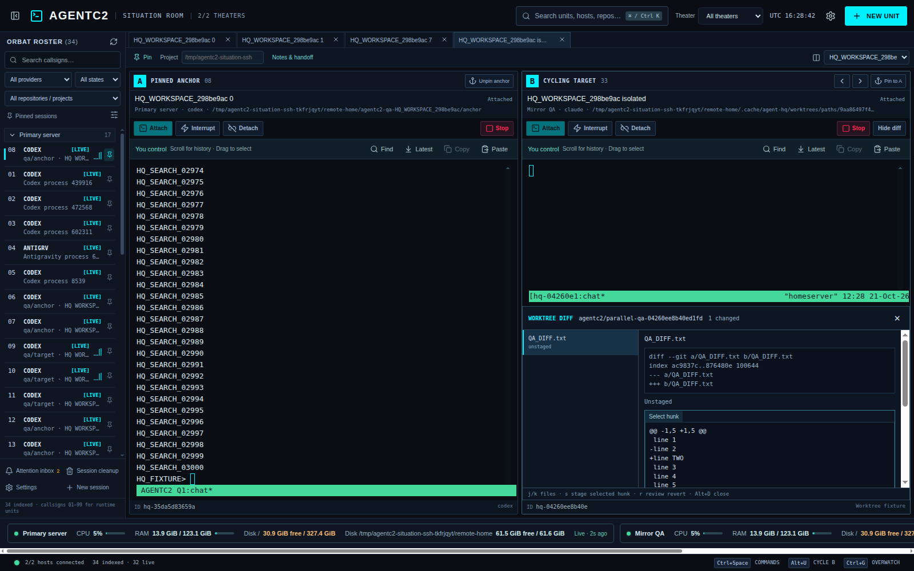

# Live worktree diffs

Select an owned worktree unit and press **Alt+D** or click **Diff** in its pane. The drawer lists changed files on that unit's SSH host, including staged, unstaged, and untracked paths. It shows staged and unstaged text hunks separately. `j`/`k` move through files while the drawer has focus; click a hunk to select it, then `s` stages that hunk and `r` opens an inline revert confirmation. Closing the drawer returns focus to the terminal. The drawer polls only while visible, retries failed reads with 6–30 second backoff, and labels its last contents stale when the host is unavailable.

At narrower widths, the drawer overlays its pane so the terminal and changed-file list remain accessible: [narrow-window screenshot](screenshots/worktree-diff-narrow.png).

Git runs on the remote host through the existing host-key-verified helper. Requests include both the managed tmux session and its worktree operation ID; the helper checks the private ownership record, current Git worktree path/branch, and tmux metadata before reading or changing files. A changed path is sent to the renderer with an opaque ID, so spaces, newlines, and Unicode do not become shell arguments. External diff helpers and text conversion are disabled. A read is limited to 100 changed files and 512 KB per file; binary changes, oversized diffs, untracked files, and file-level mode changes are labeled without hunk actions.

Hunk mutations also require the desktop to hold the session’s existing input ownership; paired observers cannot modify an owned worktree through this drawer. The renderer never supplies patch text for a mutation. Stage and revert send the selected hunk ID and snapshot revision; the remote helper regenerates the patch, rejects stale revisions, checks whether Git can apply it, and applies only that hunk. Stage changes the index only. Revert acts on the working file only after the inline confirmation. If an agent changes a reviewed hunk before the operation, Git's context check rejects the patch; changes outside that hunk are preserved. The drawer then refreshes so the user can review the current state. For untracked, binary, and mode-only changes, use Git directly in the worktree.

`tests/worktree-diff.py` checks partial staging, single-hunk revert, stale snapshots, unusual names, staged renames, binary files, large output, and wrong-unit rejection with disposable repositories. The live workspace regression checks the renderer, SSH helper, staged/index result, revert, dirty archive refusal, and cleanup against a fixture tmux unit.
