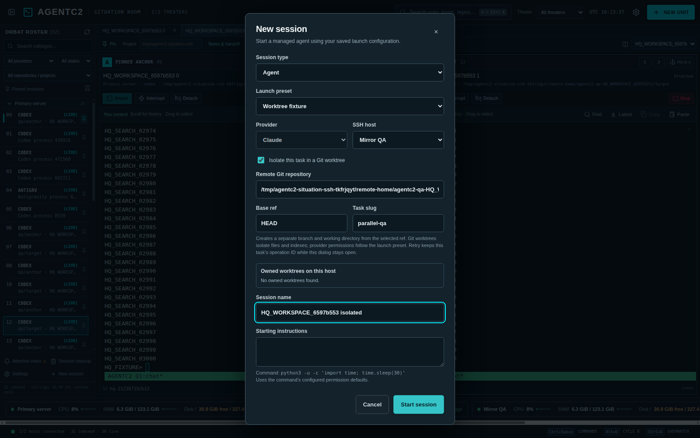

# Isolated Git tasks

In **New unit**, select an agent preset and check **Isolate this task in a Git worktree**. Enter the primary checkout of an existing repository on the selected SSH host, a base ref (default `HEAD`), and a short task slug. AgentC2 resolves the ref to a commit, creates a unique `agentc2/<slug>-<id>` branch and owned worktree below `~/.cache/agent-hq/worktrees/paths/`, then launches the agent in that directory. Ordinary working-directory launches, terminal sessions, and conversation resumes use their existing paths. Worktrees separate files and Git indexes; they do not restrict provider permissions.

Each task has a random operation ID, a deterministic tmux session name, and a private ownership record on the remote host. The record contains repository, base commit/ref, branch, path, session, and lifecycle state, but not starting instructions or terminal output. The managed tmux session also holds the operation ID. Inventory shows the branch and worktree path, and cached offline units retain the association. A retry with the same operation ID checks the recorded request and existing Git state before acting; it never launches a second agent if the tmux session already exists. If SSH fails during provisioning, reopen **New unit**, select isolation, and use **Use for retry** on a `provisioning` or `ready` record. Re-enter original starting instructions if they were present. A completed/stopped `launched` task is never silently relaunched.

The owned-worktree list previews whether each path exists, is still associated with the expected branch, has an active tmux session, contains uncommitted or untracked changes, and is merged into its recorded base ref. **Archive clean worktree** rechecks those facts on the remote host and removes only an owned, inactive, clean, merged worktree. It retains the Git branch and provider history. Dirty, unmerged, active, ambiguous, and unowned paths are refused; review them with Git before retrying. If the recorded base ref moves or disappears, the merge check uses its current value and archive remains unavailable until the branch is verifiably included. A crash after Git removes a worktree leaves a visible ownership record that can be marked archived on retry.

The remote helper uses argument-array Git commands and the existing host-key-verified SSH transport. Provisioning shares the existing launch/cleanup lock to avoid races with history deletion. It stores no credentials and does not modify unrelated worktrees or the base checkout. `tests/worktrees.py` uses disposable Git repositories for collision, retry, ownership, dirty/unmerged, and archive checks; the live workspace regression exercises Electron, SSH, tmux, inventory association, managed stop, and archive with fixture sessions.
